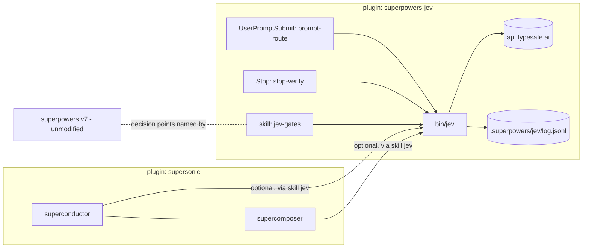

# mindlace/super — marketplace with the supersonic plugin and optional Jev judgments

Status: DRAFT — discussion surface. Edit inline; open questions are marked **OPEN**.

## Goal

1. Move superconductor + supercomposer out of dotfiles into the `supersonic` plugin
   (conductor and composer: orchestral, hence sonic), published from a public
   Claude Code plugin marketplace repo, `mindlace/super`.
2. Add optional TypeSafe **Jev** typed judgments at every decision point rated a
   STRONG fit in the 2026-10-11 assessment, so cheap ~100 ms typed calls replace or
   pre-gate Claude subagent assessments.
3. Keep superpowers itself untouched: the fork `mindlace/superpowers` is a clean
   mirror of upstream (v7.0.0, reset 2026-10-11; old work at tags
   `archive/tentacles-*`). Upstream AGENTS.md:36-38 requires third-party-service
   integrations to live in their own plugin — this repo is that plugin.

First-pass success = Jev running in **shadow mode** across Ethan's real workflow,
logging its verdict next to Claude's, with an agreement report that tells us which
points are safe to switch to `on`.

## Repo layout

```
super/
  .claude-plugin/marketplace.json      # lists both plugins
  plugins/
    supersonic/                        # conductor + composer plugin
      .claude-plugin/plugin.json
      skills/superconductor/{SKILL.md, operator-briefing.md, budget.sh}
      skills/supercomposer/SKILL.md
    superpowers-jev/                   # Jev for regular superpowers
      .claude-plugin/plugin.json
      bin/jev                          # the one helper (python3, stdlib only)
      questions/<point>.json           # versioned question templates, one per decision point
      hooks/hooks.json, hooks/run-hook, hooks/{prompt-route,stop-verify}
      skills/jev/SKILL.md              # helper contract + path discovery
      skills/jev-gates/SKILL.md        # overlay: SDD / verification / diagnosing points
  tests/                               # sh tests (ported from dotfiles) + python tests for jev
  docs/superpowers/{specs,plans}/      # this spec; superconductor design history moves here
```



### Migration from dotfiles

- `home/dot_claude/skills/{superconductor,supercomposer}` → `plugins/supersonic/skills/`
  (`executable_budget.sh` → `budget.sh`, mode 0755). Imported **with history** via
  `git filter-repo` on a scratch clone of dotfiles (paths: the two skill dirs, the
  four related tests, superconductor specs/plans/analysis docs).
- Dotfiles then deletes them from `home/dot_claude/skills/` and from `~/.claude/skills/`
  (otherwise the user-level `superconductor` shadows `supersonic:superconductor`). The
  statusline (`statusline-command.sh`, which writes `~/.claude/rate-limits.json`)
  stays in dotfiles; `budget.sh`'s contract with it is unchanged.
- Skill names become `supersonic:superconductor` / `supersonic:supercomposer`; every
  cross-reference (descriptions, ledger paths, operator-briefing) updated.
- The dotfiles README entry is replaced by a pointer to `mindlace/super`.
- Install: `/plugin marketplace add mindlace/super` (local dev: directory source
  `~/Projects/super`), then install both plugins. The official superpowers plugin
  stays installed; `superpowers-dev` (the old tentacles directory marketplace) is removed.

## The `jev` helper

One python3 stdlib script; every caller (hooks, skills, agents) goes through it.

```
jev ask <point> --state <state.json> [--call-id ID]    → JSON on stdout
jev record <call-id> <claude-verdict-json>             → appends Claude's verdict
jev report [--since DATE] [--point P]                  → per-point agreement table
jev mode                                               → prints off|shadow|on
```

- **Mode**: `SUPERPOWERS_JEV` = `off` | `shadow` | `on`. Default: `shadow` if
  `TYPESAFE_API_KEY` is set, else `off`. Per-point override:
  `SUPERPOWERS_JEV_ON=re-review,tier` promotes listed points to `on`.
- **Fail open, always**: no key, mode `off`, HTTP error, timeout (3 s), or state
  over budget → exit 0 with `{"enabled": false, "reason": "..."}`. Callers then run
  the existing Claude path unchanged. Jev can never block work by being down.
- **Question templates** (`questions/<point>.json`) hold instructions, criteria,
  option order, thresholds, and `state_schema`. `ask` validates state against the
  schema, refuses state > 28k tokens (estimated chars/4) rather than truncating,
  and sends all of a point's questions in one request.
- **Combination is code, not model**: each template declares a `combine` rule
  (`any_true_over`, `pick_if_confident`, `count_exactly_one`, …) that `ask` applies,
  returning `{verdict, confident: bool, raw}`. Jev never counts or does arithmetic.
- **Log**: every call appends to `<git-root>/.superpowers/jev/log.jsonl`
  (`call_id, ts, point, template_version, mode, verdict, confidence, raw,
  claude_verdict?`), gitignored. `report` computes agreement, Jev-confident-and-wrong
  rate, and how many Claude dispatches `on` mode would have skipped.
- Model: `jev-latest`, pinned per template via `model` field once a point goes `on`.

### Question-design rules (from TypeSafe docs; apply to every template)

- Narrow single-property questions; never "is this done/good?".
- For checks, phrase so **true = something is wrong**; escalate if any fires.
- Agent-written text (reports, findings) is passed as quoted evidence fields, never
  as instructions; questions ask about *presence of facts*, not the report's own claims.
- Choice option order puts the conservative/no-action option first (Jev has
  first-option bias; make the bias harmless).
- Always include a no-match / unclear option.

## Decision points

Thresholds below are starting values; shadow-mode data sets the real ones.
"On behaviour" is what happens only when that point is promoted to `on`; in
`shadow` the Claude path runs unchanged and Jev's verdict is logged + `record`ed.

### superpowers (overlay skill `jev-gates`, hooks)

| Point | v7.0.0 anchor | Jev question(s) | `on` behaviour |
|---|---|---|---|
| `re-review` | SDD re-review-prompt.md:80-85; SKILL.md:354-429 | per finding: choice `not_addressed / unclear / addressed` over (finding text, fix-diff hunks for its files) | any finding `not_addressed` ≥0.8 → return to implementer **without** dispatching the re-reviewer (round still counts toward the 5-cap). Otherwise dispatch re-review as today. Jev never approves alone — new-breakage check (:87-90) needs the reviewer. |
| `severity` | task-reviewer-prompt.md:145-159; code-reviewer.md:95-120 | per finding: choice `minor / important / critical` with the rubric as criteria | Jev ≥0.8 disagrees with reviewer by a level → controller adjudicates that finding inline before deciding the fix loop (SKILL.md:356-357). Agreement → no change. |
| `tier` | SDD SKILL.md:184-219 | choice `cheap / standard / capable` for implementer (task brief) and reviewer (diff stat + risk signals) using :188-199, :216-219 as criteria | pick ≥0.7 → use it and record `tier from jev p=…`; else controller decides as today. Floors in :208-214 enforced in code. |
| `report-evidence` | implementer-prompt.md:128-153; SKILL.md:286-306 | nouls (true=missing): no test command; no test output after last change; no RED output for TDD tasks; no files-changed list; DONE while concerns text present | any ≥0.7 → send implementer back for the missing evidence before `review-package`. |
| `verify-stop` | verification-before-completion SKILL.md:14-48 | Stop hook. nouls: last message claims success/completion/fix; transcript since last edit lacks a command whose output supports it | claim ≥0.8 AND unsupported ≥0.7 → `{"decision":"block","reason":…}` naming the missing evidence. Skips when `stop_hook_active`. |
| `prompt-route` | using-superpowers SKILL.md:10-31 | UserPromptSubmit hook. choice over installed superpowers skills (name+description read from the installed plugin) + `none` | pick ≥0.7 and ≠ `none` → inject `additionalContext`: "Likely applicable skill: X". Hint only. |
| `diag-confidence` | diagnosing-superpowers prompts/analyst-common.md:23-38 (+ stumbles :25-28, quality-evidence :24-26) | per analyst finding: score `low / medium / high` on whether the quoted evidence supports the finding | disagreement ≥1 level → report marks the finding "confidence contested". |

### supersonic (superconductor / supercomposer)

| Point | Anchor | Jev question(s) | `on` behaviour |
|---|---|---|---|
| `defect-class` | superconductor: Frame-defect tally | choice over existing ledger classes + `new_class` given the escalation text | pick ≥0.7 → tag with existing class (tripwire counts stay consistent); `new_class` or low → controller names a new class. |
| `bounce` | superconductor: Bounce rule | choice over live operators (slug + spec summary) + `unattributable` | pick ≥0.8 → relay to that operator's agentId; else ledger + no action, as today. |
| `operator-tier` | superconductor: Operator tier | choice of tier from spec text + interface-row counts | as `tier`. Budget state is **not a field in the state schema** — the invariant is enforced by the template and asserted by a test. |
| `surface-route` | superconductor: Supervision "Surface to your partner only" | choice `routine / requirement_contradiction / scope_change / frame_event / blocked_design_change / repeated_death` | non-routine ≥0.7 → surface to partner; `routine` → wave-boundary summary. |
| `fidelity-coverage` | supercomposer C4 fidelity leg | per spec: nouls "this spec carries requirement r" for every traceability-table requirement; code counts | requirements with 0 or ≥2 carriers become a mandatory target list in the fresh-eyes agent's brief. The agent still runs (contradictions, delegation check). |
| `citation` | supercomposer C1.3; operator-briefing "Claims carry provenance" | per `verified-at-<file:line>` claim (regex-extracted): code reads ±5 lines; choice `contradicts / says_nothing / supports` | `contradicts` or `says_nothing` ≥0.8 → claim downgraded to *unverified* in the ledger/report, and the reading agent re-checks before it enters the design. |

## Wiring

- **Path discovery**: `skills/jev/SKILL.md` states the helper is at
  `<this skill's base directory>/../../bin/jev`. Any agent (controller, operator,
  subagent) that loads `superpowers-jev:jev` knows the path; the harness prints the
  base directory on load. `supersonic` skills say: "If `superpowers-jev` is installed,
  load `superpowers-jev:jev` and run point X; otherwise skip."
- **Overlay** (`jev-gates`): a SessionStart addition from `superpowers-jev`
  (≤3 lines, only when mode ≠ off) tells the main session that `jev-gates` exists
  and applies when running SDD, verification, or diagnosing. `jev-gates` names each
  point by superpowers **section heading + v7.0.0 anchor** and checks the installed
  superpowers version; on a major-version mismatch it says so and does nothing.
- **Operators**: superconductor's operator-briefing tells operators to load
  `superpowers-jev:jev-gates` alongside SDD when the plugin is installed, so the
  SDD points fire inside operator-run SDD too.
- **Hooks** reuse superpowers' polyglot launcher pattern (extensionless scripts,
  `run-hook`, LF via `.gitattributes`); macOS/Linux supported, Windows best-effort
  (no-op if no bash/python3).

## Error handling

Covered by fail-open: any failure → `{"enabled": false}` → existing Claude path.
Hooks additionally exit 0 on any exception and never block when Jev is unavailable.
A malformed template is a test failure, not a runtime path.

## Testing

- `tests/jev/`: python unittest against a local stub HTTP server (`JEV_ENDPOINT`
  override): mode resolution, fail-open on 500/timeout/no key, state-size refusal,
  every `combine` rule, log + record + report math.
- Template lint: every `questions/*.json` validates against a meta-schema; option
  lists start with the conservative option and include a no-match option;
  `operator-tier` state schema has no budget field.
- Hook tests: canned hook-input JSON → expected output / block decision; loop guard.
- Ported dotfiles tests (`test_skill_md.sh` etc.), names updated for the plugin.
- Live smoke (`JEV_LIVE=1`): one real call per template with fixture state, asserting
  shape only.
- Calibration is not a test: `jev report` after real shadow runs is the evaluation.

## Out of scope

- Any edit to superpowers core; an upstream PR.
- The PARTIAL-fit points (spec compliance, tension audit, adjudication-answerability, …).
- Promoting any point to `on` — that's a later decision driven by `jev report`.
- Windows support beyond fail-open no-op.

## Settled decisions

- `mindlace/super` is **public**.
- Plugin is named `supersonic`; the repo stays `super`.
- superconductor's ledger path stays `.superpowers/superconductor/` so existing
  ledgers keep working.
